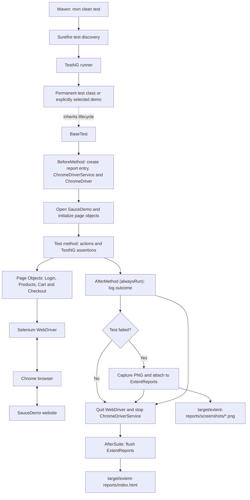

# Automation Architecture

## Overview

The project uses a small Page Object Model (POM) framework. Maven/Surefire launches TestNG, each test extends `BaseTest`, and page objects mediate browser interactions with SauceDemo. `BaseTest` also coordinates the browser lifecycle and ExtentReports.

## Component and lifecycle diagram



## Main components

| Component | Location | Responsibility |
|---|---|---|
| Maven project | `pom.xml` | Declares Java compiler release 25, dependencies, Surefire include patterns, and the default exclusion for the demo class |
| Surefire | Maven plugin configuration in `pom.xml` | Discovers and executes tests; an explicit `-Dtest=...` selector can select the reusable demo |
| TestNG | Test annotations in `org.testCases` | Runs suite, method, and test lifecycle hooks and evaluates assertions |
| `BaseTest` | `src/test/java/org/testCases/BaseTest.java` | Creates ExtentReports, initializes the per-test browser and page objects, logs test outcomes, captures/attaches failure screenshots, closes WebDriver and its service, and flushes the report |
| Permanent tests | `src/test/java/org/testCases/` | Define five business-facing UI scenarios and assertions |
| Failure demo | `FailureScreenshotDemoTest.java` in `org.testCases` | Waits for the login form, then intentionally fails to demonstrate screenshot reporting |
| Page objects | `src/main/java/org/pages/` | Hold page-specific locators and browser operations |
| SauceDemo | `https://www.saucedemo.com/` | External UI under test |
| ExtentReports | Generated output | Shows per-test statuses and links failure screenshots |
| Surefire reports | `target/surefire-reports/` | Stores per-class Maven test summaries in text and XML |

## Page Object Model

Each page object receives the WebDriver created by `BaseTest`:

- `LoginPage` enters credentials, clicks Login, and reads login errors.
- `ProductsPage` reads the product header/current URL, adds the two configured products, and opens the cart.
- `CartPage` checks product presence, removes the Backpack, and starts checkout.
- `CheckOutPage` enters checkout data, continues/cancels, and reads validation messages.
- `CheckOutOverviewPage` reads the item subtotal and finishes/cancels the order.
- `CheckOutCompletePage` reads the confirmation message and returns to products.

Tests compose those actions and use TestNG assertions to compare observed values with expected values. Keeping locators/actions in page objects reduces duplicated browser details in scenario code.

## Execution lifecycle

### Suite setup

`@BeforeSuite setupReport()` creates `target/extent-reports/`, configures an `ExtentSparkReporter` for `index.html`, creates the shared `ExtentReports` instance, and adds tester metadata.

### Per-test setup and execution

`@BeforeMethod beforeTest(Method)` creates a report entry for the test method, configures Chrome with incognito mode, starts a `ChromeDriverService` and `ChromeDriver`, sets an implicit wait, maximizes the browser, navigates to SauceDemo, and initializes page objects using that driver.

TestNG then invokes the test method. The test uses page-object methods to interact with the browser and assertions to validate the expected behavior.

### Per-test result, screenshots, and cleanup

`@AfterMethod(alwaysRun = true) getResult(ITestResult)` records the pass, fail, or skip status. On failure, it logs the throwable and captures a PNG before closing the browser. `BaseTest` writes the PNG under `target/extent-reports/screenshots/` with a class/method/timestamp filename, then attaches a report-relative path such as `screenshots/<filename>.png`.

After reporting, the teardown calls `WebDriver.quit()` and stops the corresponding `ChromeDriverService` in a `finally` cleanup path. Therefore, the browser remains open long enough to capture the failure image and is then shut down whether the test passed, failed, or was skipped after setup.

A failure before WebDriver has started may not have a browser screenshot. If a screenshot operation itself fails, the report records a warning rather than presenting a valid attachment.

### Suite completion

`@AfterSuite tearDown()` calls `extent.flush()` when the shared report object exists. This writes the final HTML after all test methods have finished.

## Test discovery

Surefire includes `Test*.java`, `*Test.java`, `*Tests.java`, `*TestCase.java`, and the specially named `HappyPath.java`. Its configured exclusion prevents `FailureScreenshotDemoTest.java` from running in the default suite. The explicit command:

```bash
mvn -Dtest=FailureScreenshotDemoTest test
```

selects only the demo for the live demonstration. Its failure is intentional. Run `mvn clean test` to execute the five permanent tests and regenerate the normal-suite report.

There is no separate `testng.xml` suite file in the project. TestNG lifecycle behavior is declared with Java annotations, while Maven Surefire controls class discovery.

## Output locations

| Output | Path | Notes |
|---|---|---|
| ExtentReports HTML | `target/extent-reports/index.html` | One generated report path; overwritten by later invocations |
| Failure screenshots | `target/extent-reports/screenshots/` | Created when a failure screenshot is successfully captured |
| Surefire results | `target/surefire-reports/` | Per-class text and XML summaries |
| Preserved passing-run evidence | `submission-evidence/final-run/` | Archived HTML report and five Surefire text summaries |
| Preserved demo evidence | `submission-evidence/live-failure-demo-reusable/` | Archived demo HTML, Surefire result, and attached PNG |

`mvn clean` removes `target/`, not the preserved evidence folders. Maven does not automatically archive generated results into `submission-evidence/`.
